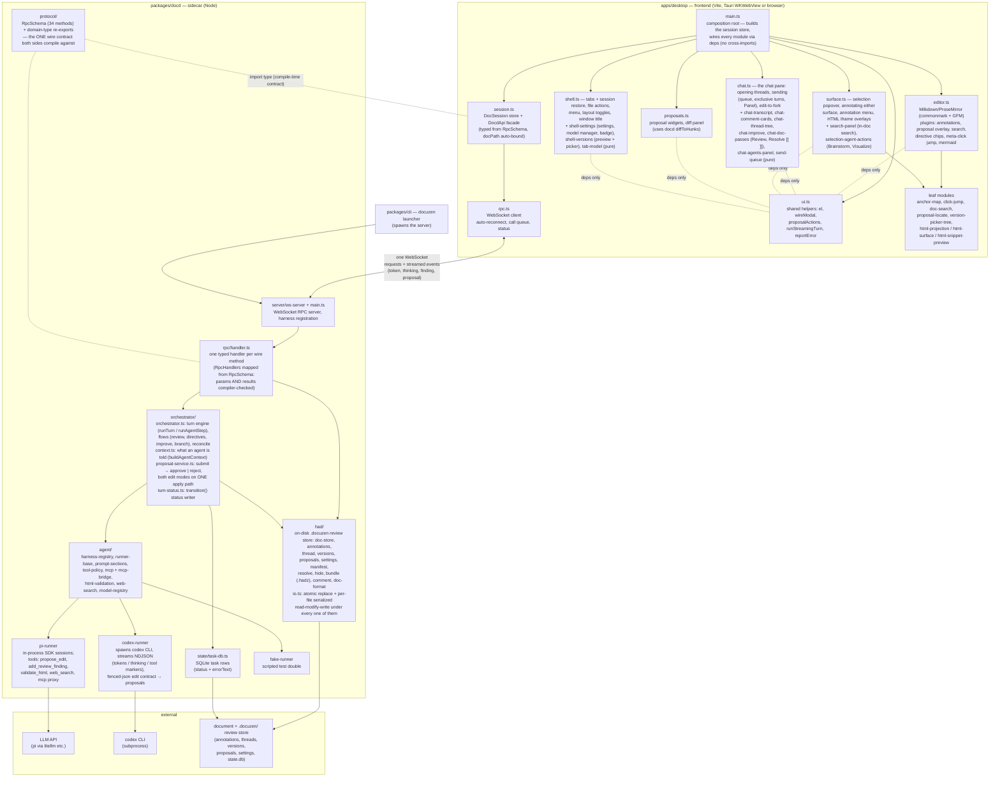
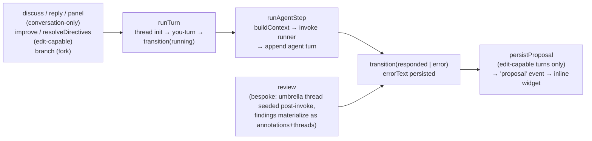

# Docuzen Architecture

Docuzen is a document-review desktop app: a **Tauri/WKWebView frontend** (also runs in a plain browser during development) talking over one WebSocket to a **Node sidecar (`docd`)** that owns all document state, agent orchestration, and LLM harnesses. Review state lives in a hidden `.docuzen/` directory at the repo root (`.docuzen/<relpath>.had/`; next to the document when it isn't in a git repo) — the document itself is never written except by explicit edit actions, and `.docuzen/` stays out of `git status` via the user's global git excludes file. Portable bundles use `.hadz`.

## System overview

## Agent turn lifecycle

Every agent interaction flows through one engine; the six entry points differ only in the spec they build. Conversation turns (discuss/reply/panel) never carry edit capability; explicit actions (Improve, Resolve `[[ ]]`, Review) do.

Key invariants the code enforces:

- **One wire contract.** `protocol/rpc.ts` types both the handler's dispatch and the desktop facade; adding a field on one side is a compile error until both agree.
- **One status writer.** `transition()` is the only code that writes turn status to the TaskDB and thread frontmatter; `reconcile()` (run on every document open) repairs rows orphaned by a crash, and one bad row can never block a document from opening.
- **One apply path.** `approveProposal` handles hunks, full rewrites, and legacy single-span proposals (converted at approve time); approve/reject are idempotent — re-resolving an already-resolved proposal reports its status instead of corrupting it.
- **Two edit modes, one write path.** Per document, agent edits are either *Suggesting* (`agentEdit: "propose"`, default — each edit is a pending proposal) or *Editing* (`"direct"` — edits from Improve / Resolve `[[ ]]` / Review apply as they arrive). Editing is "submit, then approve on the spot" inside `ProposalService`, not a second path: the agent never has write tools, every applied edit is a recorded proposal with a pre-apply backup version, HTML is validated, and an edit whose text is gone stays pending instead of being misapplied.
- **Crash- and race-safe storage.** Every review-state file is replaced atomically (temp file + rename) and every read-modify-write runs under a per-file lock (`had/io.ts`); sequential ids (annotations, proposals, versions) are allocated inside that lock.
- **Conversation ≠ edit.** Tool policy, prompt contracts, and the Codex reply parser all key off the same context predicate.

## Future work

- **A purpose-built harness on an agent SDK.** `pi` (any provider via `models.json`, multi-model Panel) and `codex` (CLI subprocess, edits via a fenced-JSON reply contract, no review findings) are the two harnesses today. The intended third is a custom harness written directly against an agent SDK, exposing `propose_edit` / `add_review_finding` as real tools with permission hooks rather than adapting a general-purpose coding CLI. The `"claude-code"` harness id is reserved for it across `HarnessId`, `HadSettings.harness` and the thread frontmatter, and the Settings UI already has a "harness-managed models" branch for a harness that brings its own model config. `HarnessRegistry` + `HarnessCapabilities` are the seam: register one more `AgentHarness`, and extend `selectRunner`'s usable-default order.
- **Remaining desktop consolidation.** The three former monoliths are split by responsibility (`chat*.ts`, `shell*.ts`, `surface.ts` + `search-panel.ts` + `selection-agent-actions.ts`), each split preceded by behavioural tests against the real DOM (`chat-behaviour`, `shell-behaviour`, `tabs-lifecycle`, `selection-agent-actions`). Still to do, in the same order (behavioural test first, then move): `chat.ts`'s edit-to-fork and Panel fan-out, `surface.ts`'s HTML-overlay rendering, and retiring the older tests that assert on source text (they read whole regions through `module-source.test-support.ts`) as behavioural tests replace them.

## Verification tooling

| Tool | What it proves | Run |
|---|---|---|
| Unit/integration suites (docd 475, desktop 401, cli 2) | module behavior; orchestration via injected `FakePiRunner`; storage atomicity + concurrency (`had/io`); both edit modes (`edit-modes`); real pi turns through the SDK against a mock model server (`pi-runner-e2e`); the desktop UI driven through index.html's real DOM with a scripted sidecar (`chat-behaviour`, `shell-behaviour`, `tabs-lifecycle`, `selection-agent-actions`) | `npm test` |
| `tools/version.mjs`, `tools/demo/check-docs.mjs` | every manifest carries the same version; docs don't describe the old storage model | `npm run test:tools` (part of `npm test`) |
| `tools/parity/` | branch behaves identically to `main` across scripted browser flows (boot, render, search, annotate, persistence, panels) | `node tools/parity/run.mjs --main <tree> --candidate <tree>` |
| `tools/parity/reconnect-drill.mjs` | live kill/restart of the sidecar under a running app self-heals without reload | `npm run drill:reconnect` |
| `tools/live/run.mjs` | every agent flow against a REAL model through the real sidecar RPC: discuss/reply, Improve → approve, directives, review, Editing mode, built-in + MCP tool use. Structural assertions only. Needs a keyed pi model; costs tokens; not in `npm test` | `npm run live` (`-- --model provider/id`, `-- --only discuss,direct`) |
| `tools/live/ui.mjs` | the real frontend + real sidecar + a real model in a browser: comment → Ask agent → a message queued mid-turn → reply → Improve → Apply | `npm run live:ui` |
| `tools/visual/` | 14 baseline screenshots (7 key states × light/dark OS scheme) pixel-match | `npm run visual` (`--update` to accept changes). Hermetic: the sidecar runs with a throwaway HOME, so results don't depend on the developer's config |
